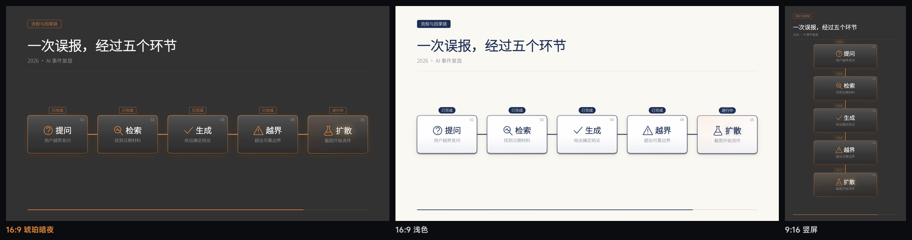

# Science Motion Skills · 科普动效技能库

十套可配置、可复现的科普视频动效。提供独立 Python 渲染脚本、HTML/Canvas/SVG 源码、JSON 配置示例、中文字体和代表样片，可作为 Codex 技能使用，也可以直接从命令行导出视频。

**代码与原创示例采用 MIT 开源许可证，可修改、分发和商用。字体保留 SIL OFL 1.1。**

## 动效目录

| 编号 | 动效 | 技能与参数入口 | 样片 |
| --- | --- | --- | --- |
| 001 | 聊天动效 | [001-chat-motion-render](skills/001-chat-motion-render/SKILL.md) | [MP4 · 七套 UI](previews/001-chat-motion-render-v02.mp4) |
| 002 | 流程与因果链 | [002-flow-motion-render](skills/002-flow-motion-render/SKILL.md) | [琥珀暗夜](previews/002-flow-motion-render-v03-amber.mp4) · [浅色](previews/002-flow-motion-render-v03-light.mp4) · [竖屏](previews/002-flow-motion-render-v03-portrait.mp4) |
| 003 | 多尺度连续缩放 | [003-multiscale-zoom-render](skills/003-multiscale-zoom-render/SKILL.md) | [MP4](previews/003-multiscale-zoom-render.mp4) |
| 004 | 对照实验双屏 | [004-split-compare-render](skills/004-split-compare-render/SKILL.md) | [MP4](previews/004-split-compare-render.mp4) |
| 005 | 手机聊天与锁屏通知 | [005-phone-ui-motion](skills/005-phone-ui-motion/SKILL.md) | [MP4](previews/005-phone-ui-motion.mp4) |
| 006 | 分层剖面与拆解 | [006-layer-explode-render](skills/006-layer-explode-render/SKILL.md) | [MP4](previews/006-layer-explode-render.mp4) |
| 007 | 地震局监测屏 | [007-quake-monitor-render](skills/007-quake-monitor-render/SKILL.md) | [MP4](previews/007-quake-monitor-render.mp4) |
| 008 | 终端 / 代码动效 | [008-terminal-motion-render](skills/008-terminal-motion-render/SKILL.md) | [MP4](previews/008-terminal-motion-render.mp4) |
| 009 | 斩杀线标尺 | [009-threshold-line-render](skills/009-threshold-line-render/SKILL.md) | [MP4](previews/009-threshold-line-render.mp4) |
| 011 | 自由卡片动效 | [011-ppt-card-motion-render](skills/011-ppt-card-motion-render/SKILL.md) | [MP4](previews/011-ppt-card-motion-render-v02.mp4) |

在本地浏览器打开 [gallery.html](gallery.html) 可观看十套技能的样片。GitHub 源码页面不能执行 HTML；请下载仓库后打开。视频为已渲染的代表案例，配置可按新主题修改。

## v1.5.0 · 2026-11-17

**002 流程与因果链 v3.0.0** 把同一条五节点流程排成三版。琥珀暗夜横屏用连续圆角、细边缘光和暖色辉光突出当前节点。浅色横屏用底部阴影和文字投影。竖屏把五卡改为纵列，放大标题与图标。三版均为 11.5 秒，各自附可重渲的配置。[琥珀暗夜配置](skills/002-flow-motion-render/assets/examples/showcase-amber.json) · [浅色配置](skills/002-flow-motion-render/assets/examples/showcase-light.json) · [竖屏配置](skills/002-flow-motion-render/assets/examples/showcase-portrait.json)



**001 聊天动效 v2.2.0** 的七套聊天界面支持透明叠加。001 和 002 都可用 `--alpha` 导出带透明通道的 VP9 WebM，用于把聊天界面或流程卡片放到已有视频上。常规导出为无声 H.264 MP4。下例从仓库根目录运行，需要 FFmpeg 带 `libvpx-vp9` 编解码器。

```bash
python skills/001-chat-motion-render/scripts/render_chat.py --config skills/001-chat-motion-render/assets/examples/basic.json --output output/chat-overlay.webm --alpha
python skills/002-flow-motion-render/scripts/render_flow.py --config skills/002-flow-motion-render/assets/examples/showcase-amber.json --output output/flow-amber.mp4
```

维护时运行 `python tools/sync_runtime.py` 核对各技能的渲染器。`catalog.json` 在 001 和 002 上指定 2.1.0，共享源码位于 `shared/2.1.0/`。其余技能沿用仓库默认的 2.0.0。

## 安装环境

需要 Python 3.10+、Chrome/Chromium、FFmpeg 与 ffprobe。

```bash
python -m venv .venv
# Windows PowerShell: .venv\Scripts\Activate.ps1
# macOS / Linux: source .venv/bin/activate
python -m pip install -r requirements.txt
python -m playwright install chromium
```

FFmpeg 和 ffprobe 需安装到 PATH，或使用 `--ffmpeg` 指定 FFmpeg 的路径，ffprobe 应位于同一目录。浏览器按 CHROME_BIN、PATH、系统常见位置、Playwright Chromium 的顺序发现；也可以使用 `--chrome` 显式指定。FFmpeg 支持 FFMPEG_BIN 环境变量。本仓库不附带上述外部运行时。

本次发布在 Windows、Python 3.12.10、Playwright 1.65.1、Pillow 13.0.0 和本机 Chrome 上验证。包含其他平台的路径发现支持，macOS/Linux 的完整渲染尚未实测。

## 快速开始

先检查完整“斩杀线 → 起跑线”示例：

```bash
python skills/009-threshold-line-render/scripts/render_threshold.py --config skills/009-threshold-line-render/assets/examples/combined.json --output output/threshold.mp4 --check-only
```

再导出视频（检查阶段已经创建源目录，所以加 `--overwrite`）：

```bash
python skills/009-threshold-line-render/scripts/render_threshold.py --config skills/009-threshold-line-render/assets/examples/combined.json --output output/threshold.mp4 --overwrite
```

输出无声 H.264 MP4 与 `output/threshold_source/` 离线预览、配置和验证报告。`--check-only` 不生成新视频。所有输出都必须位于技能目录之外。含图片/视频的配置使用相对路径时，修改主题须同时保留对应素材。

每套技能的 `SKILL.md` 说明具体流程；详细参数位于 `references/config.md`。原始模板与示例在 `assets/`。前后段独立使用、竖屏支持等能力因技能而异，请查看各自说明。场景数值为机制示意，不是实测性能、排名或实验结论。

## 安装为 Codex 技能

```bash
python tools/install_skills.py
```

默认安装到 `~/.codex/skills`（设置 CODEX_HOME 时使用该目录下的 skills），也可传 `--destination <路径>`。安装器遇到任何同名技能会停止，不覆盖本机已有版本；先使用 `--dry-run` 查看将安装的目录。每套技能自带必要源码与字体，安装后可独立使用。

例如：`使用 $009-threshold-line-render，做一个质量门槛动画，只使用前半段。`

## 编号与贡献

- `catalog.json` 是编号索引；现有自建技能 001–009、011；010 已停用，下一个为 012。
- 新技能采用 `NNN-kebab-case`，目录、SKILL name 与显示名编号一致；已有技能增加主题沿用原编号。
- 修改应保留确定性的时间定位、可替换配置、字体许可和必要验证。不要提交密钥、个人路径、运行环境、临时帧或私人业务脚本。
- 运行 `python tools/check_release.py` 检查包结构、配置文件、许可证和 Python 语法。动态检查需依赖环境与浏览器，按各技能运行 `--check-only`，正式视频还需检查解码和画面。

## License

See [LICENSE](LICENSE) and [THIRD_PARTY_NOTICES.md](THIRD_PARTY_NOTICES.md). Fonts remain under their bundled OFL license. Product names identify independent, stylized demonstrations and imply no affiliation.

## English overview

Ten configurable motion-rendering skills for science communication: chat, flow and causality, multiscale zoom, split comparison, phone conversation/notifications, exploded layers, event monitoring, terminal/code, threshold/start-line animation, and freeform card motion. Run the Python renderers directly or install the folders as Codex skills. JSON examples and editable browser-based engines are included. Original code and examples are MIT licensed; bundled fonts retain SIL OFL licensing. Windows is verified; other platforms have portable tool discovery but have not received full rendering validation.

## v1.1.0 · 2026-11-14

所有九套技能加入共同渲染 2.0：按原时间轴导出帧段、关键帧 PNG、有限范围 BT.709、编码后 PTS 与完整解码检查。005 新增半截手机、硬件细节与消息安全区；002 新增连续虚线、分道回程和路径诊断；009 新增像素角色、细节跑道与实际轮廓越线。上述三项新样片位于 gallery 的 v02 区域，原样片保留。

新选项均为可选配置；旧配置保留原布局。`shared/` 保存共同渲染源码，`python tools/sync_runtime.py` 检查九份副本，`--apply` 同步副本。007 / 008 在本次公开版本中只更新共同渲染层。

## v1.2.0 · 2026-11-14

007 新增固定监测带：统一事件配置驱动波峰、月份、数值定格与盖章，可跨镜头复用。008 新增长命令与日志折行、原始行到显示行的映射、长标签和字段强调，以及完整原始行放大。两套模板均可选暗夜配色，默认保留旧布局。配置分别见 `monitor-band.json` 和 `readable-terminal.json`。两条 v02 样片已加入 gallery，原有样片保留。


## v1.3.0 · 2026-11-15

新增 011 自由卡片动效 v2：每个元素独立设置大小、位置、层级与动作，支持几何关键帧、曲线路径、透视翻转、进退场和编组。八种 UI 外观可独立使用或混用，无固定看板布局。50 秒认可样片与八份分场景配置随包提供，原看板配置保留兼容。详细参数见 `skills/011-ppt-card-motion-render/references/freeform.md`。不编辑原生 PPTX 动画。

## v1.4.0 · 2026-11-17

001 聊天动效升级为七套 UI：Messages、微信、WhatsApp、Claude、ChatGPT、X 公开回复串、Google Gemini。支持浅色/深色、横屏/竖屏、逐字输入和整条弹出，逐字输入已去掉光标；消息时间和反馈操作在正文完成后出现。94.5 秒无声对比样片与七份配置示例随包提供。

当前仅提供七套 UI，逐字输入无光标，导出无声视频。界面为独立风格化重绘，系统字体不可用时回退到随包 OFL 中文字体。

例如导出深色 X 公开回复串：

```bash
python skills/001-chat-motion-render/scripts/render_chat.py --config skills/001-chat-motion-render/assets/examples/x.json --output output/x-thread.mp4
```

完整配置见 [001 参数说明](skills/001-chat-motion-render/references/config.md)，UI 参考与字体说明见 [设计依据](skills/001-chat-motion-render/references/design.md)。

## v1.4.1 · 2026-11-17

001 技能更新为 v2.1.0，删除旧版四套模板、简洁卡片配置和旧代表样片，保留七套已认可的 UI 与无光标 v02 对比样片。旧配置中的 `ui: legacy` 与 `theme: minimal` 不再接受，请改用七套界面之一。其余技能保持原版本。
